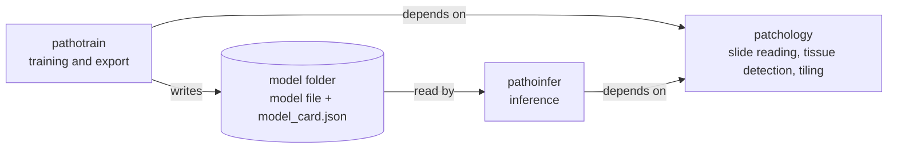

# pathoinfer

<p align="center">
  
</p>

> [!WARNING]
> For research use only. Not a medical device. Outputs must not be used for diagnosis or
> any clinical decision.

pathoinfer runs a trained model over a whole slide image (WSI) and writes the result in
formats people view and analyse. It reads the slide through
[patchology](https://github.com/twpkevin06222/patchology), keeps tiles that hold tissue,
runs the model on them in batches, stitches the tile outputs back into one slide-level
result, and writes:

- **GeoJSON** for QuPath and other viewers;
- **Parquet** for analysis with Polars or DuckDB;
- **pyramidal TIFF** for raster outputs such as label maps.

| Task | Model output | Slide-level result |
|---|---|---|
| Segmentation | per-pixel class logits | one polygon per region, holes kept, seams merged |
| Detection | boxes, scores, labels | one object per detection, each reported once across tile overlaps |
| Tile classification | per-tile class logits | heatmaps; lands in v0.2 |

## How it fits together



pathoinfer never imports pathotrain. The only link between them is the **model folder**:
the model file plus a `model_card.json` (the ModelCard) that says how to feed the model
and read its outputs: tile size, resolution, normalisation, classes and output tensors.
pathoinfer owns the ModelCard schema ([docs/model_contract.md](docs/model_contract.md)),
so any model with a valid card runs, whoever trained it.

## Install

Requires Python 3.12 or later.

1. Install PyTorch for your hardware first, from [pytorch.org](https://pytorch.org/get-started/locally/).
   For example, for CUDA 13.0:

   ```bash
   pip install torch --index-url https://download.pytorch.org/whl/cu130
   ```

   Or for CPU only:

   ```bash
   pip install torch --index-url https://download.pytorch.org/whl/cpu
   ```

2. Install patchology, then pathoinfer with the extras you need. Neither is on PyPI yet,
   so both come from GitHub, patchology first:

   ```bash
   pip install "patchology @ git+https://github.com/twpkevin06222/patchology"
   pip install "pathoinfer[onnx] @ git+https://github.com/twpkevin06222/pathoinfer"
   ```

| Extra | Adds |
|---|---|
| `onnx` | ONNX Runtime (GPU build; runs on CPU too). Needed for `.onnx` models |
| `mlflow` | Models from an MLflow registry: `models:/NAME@ALIAS` |
| `hf` | Models from the Hugging Face Hub: `hf://ORG/REPO` |
| `geopandas` | `pathoinfer.io.interop.to_geodataframe` |
| `trt` | TensorRT plans (`pathoinfer convert trt`) and their runtime |
| `convert` | FP16 and INT8/FP8 conversion (`src/pathoinfer/convert/README.md`) |
| `triton`, `vllm-client` | Clients for models on Triton or vLLM servers |
| `serve` | The slide job API (`src/pathoinfer/serving/README.md`) |

Check the install:

```bash
pathoinfer --help
pathoinfer info slide slide_name-01.svs     # size, levels, resolution
```

## Quickstart

Every run is one YAML file. Copy an example from [examples/](examples/), point it at your
model and slides, check it, then run it:

```bash
pathoinfer validate my_run.yaml     # config, model and slides; runs nothing
pathoinfer run my_run.yaml          # writes into outputs.dir
```

`pathoinfer run` loads the model once, runs every slide, and skips slides already
finished with the same settings, so an interrupted run can be started again. A slide
that fails is logged and recorded in the batch summary; the others carry on. Add `-v`
for detailed logs.

Slides must report their resolution (microns per pixel) in their metadata; pathoinfer
refuses slides that do not, rather than guess.

### Segmentation

```yaml
# my_run.yaml
task: segmentation
model: models/tumour-seg          # model folder, models:/NAME@ALIAS or hf://ORG/REPO
slides: slides/*.svs              # a path, a glob, or a .txt/.csv/.parquet list
segmentation:
  min_area_um2: 50                # drop smaller regions
  fill_holes_um2: 200             # fill smaller holes
outputs:
  dir: outputs/segmentation
```

Per slide: `<slide>.geojson.gz` with one polygon per region, `<slide>.objects.parquet`,
`<slide>.summary.parquet` and, with `outputs.tiff: true`, `<slide>.labels.tiff`.
Outlines are simplified and smoothed by default (`simplify_px`, `smooth`); see
[examples/segmentation.yaml](examples/segmentation.yaml) for every option.

### Detection

```yaml
task: detection
model: models/cell-detector
slides: slides.csv                # a `path` column
detection:
  score_threshold: null           # null: the model card's threshold
  geometry: point                 # point (centre) or box
outputs:
  dir: outputs/detection
  per_class: true                 # one GeoJSON per cell type
```

Each detection is kept by exactly one tile, so objects up to about the tile overlap wide
are never counted twice. See [examples/detection.yaml](examples/detection.yaml).

### Tile classification heatmaps

Not available in 0.1.0: `pathoinfer validate` accepts a classification config
([examples/classification.yaml](examples/classification.yaml)) and `pathoinfer run`
reports that classification runs land in v0.2. They will write per-class probability
heatmaps as pyramidal TIFFs and one tile object per tile with `prob_<class>`
measurements.

## Bring your own model

Any model exported to ONNX or PyTorch (`torch.export` `.pt2`, or TorchScript) runs once
it has a ModelCard. `pathoinfer card create` writes the model folder; it reads what it
can from the file and takes the rest from a YAML file:

```yaml
# fields.yaml
task: segmentation
version: "1.0"
input:
  tile_size: 512
  mpp: 0.5                        # microns per pixel the model was trained at
  normalisation: {mean: [0.485, 0.456, 0.406], std: [0.229, 0.224, 0.225]}
classes:
  - {id: 0, name: background, color: [0, 0, 0]}
  - {id: 1, name: tumour, color: [220, 40, 40]}
background_id: 0
output: {activation: logits, n_classes: 2}
recommended_overlap: 0.25
```

```bash
pathoinfer card create my_model.onnx models/tumour-seg --fields fields.yaml --name tumour-seg
pathoinfer card validate models/tumour-seg     # card valid, ONNX graph matches it
pathoinfer info model models/tumour-seg
```

If anything is missing or wrong, `card create` lists every field and writes nothing.
[docs/model_contract.md](docs/model_contract.md) documents every field, including
detection outputs (`box_format`, `box_units`, `score_threshold`).

## Outputs

[docs/outputs.md](docs/outputs.md) describes every file, field and column. Every output
records the run: slide id, model name and version, pathoinfer and patchology versions,
resolutions, tile size and overlap.

**GeoJSON** follows QuPath's format (`objectType`, `classification`, `measurements`).
Open the slide in QuPath, then File > Import objects; see [docs/qupath.md](docs/qupath.md).
To check alignment without QuPath:

```bash
python scripts/qc_overlay.py slide_name-01.svs outputs/segmentation/slide_name-01.geojson.gz
```

**Parquet** has one row per object: class, score, centroid, bounding box, `area_um2`,
measurements and the geometry as WKB.

```python
import polars as pl
import shapely

objects = pl.read_parquet("outputs/segmentation/slide_name-01.objects.parquet")
print(objects.group_by("class_name").agg(pl.len(), pl.col("area_um2").sum()))
shapes = shapely.from_wkb(objects["geometry"].to_numpy())
```

Across many slides, with DuckDB:

```python
import duckdb

duckdb.sql("""
    SELECT slide_id, class_name, count(*) AS n, median(area_um2) AS median_um2
    FROM read_parquet('outputs/segmentation/*.objects.parquet', union_by_name = true)
    GROUP BY ALL ORDER BY ALL
""").pl()
```

`pathoinfer.analysis` has ready-made queries, such as objects per mm² of tissue:

```python
from pathoinfer.analysis import class_density

class_density("outputs/detection/*.objects.parquet", "outputs/detection/*.summary.parquet")
```

**TIFF** label maps are tiled, compressed pyramids with resolution tags, so tools that
scale by physical pixel size lay them over the slide.

## Coordinates

Every output uses **level-0 pixel coordinates** of the slide: origin at the top-left
corner, x to the right, y down, as QuPath does. Pixel `(i, j)` covers `[i, i+1] x
[j, j+1]`, so polygon outlines follow pixel edges. These are not geographic coordinates:
GeoJSON here is not RFC 7946 longitude and latitude, and a GeoParquet file written with
`outputs.geoparquet: true` names a pixel coordinate system, not WGS84. Areas and lengths
are in µm and µm², from the slide's resolution.

## Development

pathoinfer is developed in a uv workspace next to patchology and pathotrain. CI
([.github/workflows/ci.yml](.github/workflows/ci.yml)) installs only patchology and
pathoinfer into a clean environment with CPU PyTorch, then runs ruff, mypy and the tests
(GPU tests are skipped) and builds the wheel. To run the same checks locally:

```bash
uv pip install -e ".[onnx]" --group dev
ruff check && ruff format --check
mypy src
pytest
```

Changes are listed in [CHANGELOG.md](CHANGELOG.md).

## License

Apache License 2.0, see [LICENSE](LICENSE).
